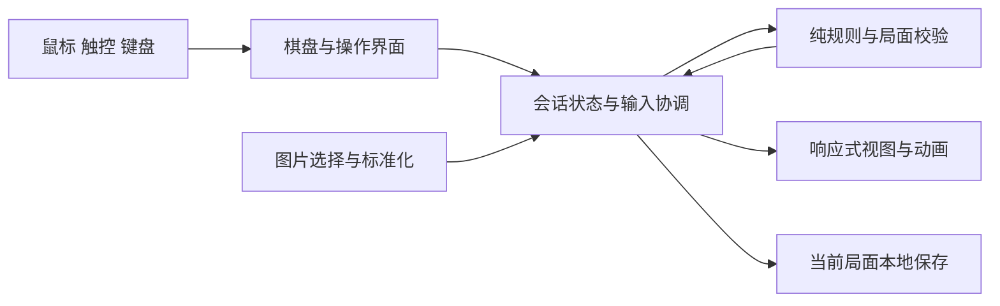

# Web 拼图游戏首版规格

状态：实施中，玩法、技术栈与工程工具已确认，进度见 [PR 计划](web-puzzle-v1-pr-plan.md)。更新日期：2026-10-15。

实现一个打开浏览器即可游玩的单人拼图游戏，采用《绝区零》拼图活动的拖拽换位规则，保留“归位闪光后变暗、全部完成后整图亮起”的反馈。首版覆盖桌面鼠标、手机触控和键盘操作，图片与进度保存在当前浏览器。

本文是首版行为与验收的事实来源。用户已确认：图块归位后锁定，保留原图比例并完整展示图片，采用独立界面并保留原作的交互配色和拼图动效；提供内置 3 张示例图与本地上传、下表所列的完整基础功能，小屏按宽度适配棋盘；使用 Vue 3、TypeScript、Vite 和 Tailwind CSS，并将开局是否预留归位图块做成选项。工程工具使用 oxlint、oxfmt、lint-staged 和 simple-git-hooks，CI 保持轻量。本文规定的锁定、图片处理、异常处理和动画参数属于 Web 版设计选择。

## 目标与范围

玩家可以选择一张图片和网格大小，经过“拿起、换位、归位、完成”体验完整的一局。成功标准是操作结果可预期，触控不会误触页面滚动，动画与棋盘状态一致，刷新后能够继续最近一局。

| 项目     | 首版范围                                         |
| -------- | ------------------------------------------------ |
| 图片     | 内置 3 张示例图，支持从设备选择单张图片          |
| 网格     | 3×3、4×4、5×5、6×6，默认 4×4                     |
| 开局方式 | 辅助开局、随机开局，默认辅助开局                 |
| 操作     | 拖拽交换、依次点选两格交换、键盘交换             |
| 辅助     | 查看原图、查看归位进度和交换次数、重新打乱、换图 |
| 记录     | 自动保存最近一局，包含上传图片；刷新后恢复       |
| 界面     | 独立的深色界面，使用黄绿色交互提示和金色成功反馈 |
| 交付     | 单页静态 Web 应用，无账号、后端或外部运行时 API  |

首版不包含活动剧情、角色场景、奖励系统、排行榜、计时挑战、拼块旋转、拼块成组拖动、撤销、联网对战、图片分享、关卡编辑器和音效。示例图随应用提供，首版无需登录或额外配置。

## 参考行为与设计取舍

上一轮调研对照了[「赠尔·丽都」实机录像](https://www.bilibili.com/video/BV1qY1CYuEq8/)与[「拼出澄辉夏日！」实机录像](https://www.bilibili.com/video/BV1MoeKzMEqp/)。夏日录像约 12 至 18 秒展示了拖动、换位、局部归位和全图完成。

| 参考中观察到的行为                 | Web 版采用方式                                       |
| ---------------------------------- | ---------------------------------------------------- |
| 图块可以跨行、跨列交换             | 任意两个未归位格均可交换                             |
| 归位图块闪金光后变暗，相邻边界消失 | 归位图块锁定，亮度降低，仅隐藏两侧均已归位的内部边线 |
| 全图完成后金光掠过，整图恢复亮度   | 使用一次完整的完成动效，随后保留整图供查看           |
| 可以查看原图、完成后重新打乱       | 增加明确的原图切换按钮，未完成时也允许主动重开       |

录像未覆盖已归位块再次拖动、越界释放和浏览器中断。本版选择“归位即锁定、无效释放回原位、中断不产生新交换”，避免玩家破坏已完成区域。相邻归位块只在视觉上连成一片，不产生新的组合图块。

## 一局游戏的规则

### 图块与归位

图片保留原始长宽比，按所选网格均分，棋盘与单个图块都可以是矩形。例如，横向图片选择 4×4 时，仍为 4 行、4 列，共 16 块，每块都是横向矩形。格位和图块分别具有稳定编号，均按从左到右、从上到下的顺序编号；图块的编号同时确定它在完整图片中的目标格位。

- 每格恰好包含一块图，每块图恰好出现一次；棋盘没有空格。
- 图块朝向固定，只允许改变所在格位。
- 图块位于自己的目标格位时，立即视为已归位。初始局面中的正确图块也适用。
- 已归位图块不能拿起，已归位格不能作为交换目标。点击它只保留焦点，不改变选择或棋盘。
- 合法交换必须涉及两个不同的未归位格。松手确认时，两格内容一次性互换，交换次数增加 1。
- 交换后重新判断两块图是否归位；可能归位 0、1 或 2 块。没有归位的交换仍然有效，不触发失败惩罚。
- 所有格位都正确即完成。没有时间、步数上限和失败结算。

锁定不会导致死局：已归位图块占据自己的唯一目标格，其余图块的目标格仍在未归位集合内，而该集合中的任意两格都能交换。

### 初始局面与重开

开局方式在选图面板中选择，与网格大小相互独立：

| 方式           | 标识       | 生成规则                                                                         |
| -------------- | ---------- | -------------------------------------------------------------------------------- |
| 辅助开局，默认 | `assisted` | 先随机保留总格数四分之一的图块归位，数量向下取整；其余格位使用 Fisher-Yates 洗牌 |
| 随机开局       | `random`   | 不预留归位块，全部格位使用 Fisher-Yates 洗牌                                     |

两种方式中，洗牌偶然产生的正确图块同样归位并锁定，随机开局不保证所有图块都错位。如果结果完全正确，则交换两个未被预留的格位，保证至少有两块需要处理。辅助开局的初始归位数量可能高于预留数量。无需生成步数评级或搜索特定难度局面。

“重新打乱”保留当前图片、网格与开局方式，重新执行上述生成过程，交换次数归零，归位数量重新计算。没有有效交换的局面和已完成局面直接重开；未完成且已有有效交换时，确认“重新打乱将清除本局进度”，提供“取消”和“重新打乱”。

### 进度与完成

棋盘外显示“已归位 8 / 16”和“交换 5 次”。归位数量包含初始正确图块，读取当前棋盘计算，不单独维护一份计数。

最后一次合法交换提交后，逻辑上立即完成，输入停止，播放完成动效。动画结束后显示“拼图完成”，保留完整图片与交换次数，并提供“再来一局”和“换张图片”。完成判定和存档均不依赖动画结束事件。

## 图片与页面流程

### 选择图片

首次进入展示图片选择、网格选择、开局方式和整图预览，默认选中第一张示例图、4×4 与辅助开局；点击“开始拼图”进入棋盘。有有效存档时直接恢复棋盘，通过“换张图片”重新打开选择面板，候选配置初始值取当前局面配置。

内置示例图采用随包提供的原创静态画面，分别为彩色几何、城市窗格、植物静物。每张图具有明确的局部形状与色彩差异，避免大面积纯色让相邻图块无法辨认。资源标识分别为 `geometry`、`city-windows`、`plants`，路径位于 `public/images/`。

设备选图使用文件选择器，界面说明“图片仅在此浏览器中处理和保存”。支持 JPEG、PNG、WebP，单文件上限 10 MiB；解码后总像素不超过 2000 万。超限、格式不支持或解码失败时，显示具体原因，保留当前图片与局面。

所有图片采用同一处理流程：应用图片方向信息，保留完整画面与原始长宽比，必要时等比缩小至最长边不超过 2048 像素，不放大小图；透明区域铺底色 `#202124`，生成静态 PNG Blob。设置面板必须在开局前展示这张最终图片；首版不提供裁切与缩放编辑。

“查看原图”展示的是实际参与拼图的标准化图片。棋盘、预览与完成图共用这一份图像和长宽比，均展示完整画面。

### 换图与调整开局配置

换图、改网格或切换开局方式在选择面板中先形成候选配置，关闭面板不改变当前游戏。图片成功处理并点击“开始新局”后，才创建新局；当前局面未完成且已有有效交换时，确认一次清除进度。切换开局方式不会在当前局面中途增加、移除或解锁图块。

新图片准备期间保留旧局面，暂时禁用开始按钮并显示处理状态。连续选择图片只采用最后一次选择的结果，较早完成的异步请求不得覆盖当前候选图片。关闭选择面板会废弃尚未完成的候选请求。

### 查看原图

点击“查看原图”在棋盘范围内覆盖完整图片，按钮变为“返回拼图”；再次点击或按 Escape 返回。查看期间禁止操作图块，选择状态清空，棋盘排列、归位状态和交换次数保持不变。完成后该按钮隐藏，整图已直接可见。

### 页面布局

页面从上到下为标题与进度、棋盘、操作栏。操作栏包含“查看原图”“重新打乱”“换张图片”；网格大小与开局方式在换图面板中调整。完成提示位于棋盘下方，不遮挡图片。

棋盘内容区域保留图片长宽比，宽度取可用宽度与 640 CSS 像素中的较小值，高度由图片比例确定，水平居中。页面左右最少留 16 CSS 像素，窄屏操作栏可换行；高度不足时允许整页纵向滚动。支持最小视口宽度 320 CSS 像素，格位宽、高分别由棋盘内容宽、高除以每边格数计算，命中与动画不能假定两者相等。

小屏优先按屏幕宽度展示完整棋盘，不产生横向溢出，长图通过整页纵向滚动查看。宽图配合密集网格时，格位短边可能小于 44 CSS 像素；用户已接受这一取舍。首版不增加独立的棋盘缩放和平移操作，浏览器页面缩放保持可用。

采用系统字体、深灰背景和清晰文字对比。选择面板与重开确认使用具有焦点管理的对话框，关闭后焦点回到触发按钮。正常游玩时不显示技术字段、存储结构或图片处理参数。

## 输入行为

### 鼠标和触控

使用 Pointer Events 统一鼠标、触控笔与触摸输入。每次只接受一个主指针，鼠标只接受主键；图像的浏览器原生拖动和棋盘内文本选择关闭。

1. 在未归位图块上按下后，记录来源格与按下点，并在稳定的棋盘容器上捕获该指针。此时不改变排列。
2. 指针距按下点的直线距离达到 6 CSS 像素后进入拖动；浮动图块保留按下位置与图块的相对偏移，拿起时不跳到指针中心。
3. 拖动期间按指针位置标记目标格。有效目标须在棋盘内、不同于来源格且未归位；移动过程中只更新预览。
4. 松手时重新判断目标。合法则执行一次交换；落在来源格、已归位格或棋盘外则回原位，不增加交换次数。

目标命中依据棋盘内容区域，不包括外框，也不依据浮动图块的覆盖面积。左右、上下边界分别采用左含右不含、上含下不含规则；边线属于右侧或下侧格，避免一次命中两格。

未达到拖动阈值的按下与释放按点选处理：点第一格选中，点另一未归位格交换，点同一格取消选择。已有点选来源时，从另一格开始拖动将清除原选择，并以实际拿起的图块为来源。一次手势只能进入拖动或点选路径，释放后的合成点击不得再执行交换。

长图跨屏交换使用两次点选：先选中来源格，再从棋盘外滚动页面，最后点选另一未归位格完成交换。没有活动图块手势时，页面滚动保留选择，来源格离开视口也不取消选择或触发交换。下一次点选按滚动后的棋盘位置判断目标，焦点更新不得将页面强制滚回来源格。拖动图块到视口边缘不触发自动滚屏。

棋盘设置 `touch-action: pinch-zoom`，单指用于拼图，棋盘外可正常滚动页面；浏览器接管双指缩放时通过取消事件结束当前手势。页面不全局禁用缩放。指针捕获期间不会正常产生目标格的移入移出事件，因此目标格由坐标计算。[Pointer Events](https://developer.mozilla.org/en-US/docs/Web/API/Pointer_events) · [touch-action](https://developer.mozilla.org/en-US/docs/Web/CSS/touch-action)

### 键盘

Tab 进入棋盘时只产生一个停靠点；方向键在格位间移动焦点，遇边界停止，不跨行循环。Enter 或空格在未归位格上选中来源，再在另一个未归位格上确认交换；在同一来源格上再次确认则取消选择，Escape 取消当前选择。棋盘处理方向键和空格时阻止它们滚动页面，Tab 保持正常离开棋盘的行为。

已归位格仍可被方向键聚焦，标记为已归位并禁止激活。交换后焦点保留在确认操作的格位，不因图块移动丢失。图块标签包含当前行列和归位状态；状态区域以礼貌播报方式报告归位数量与完成结果，不逐帧播报拖动位置。

## 状态与中断

| 状态     | 允许的行为                                     | 退出条件                                               |
| -------- | ---------------------------------------------- | ------------------------------------------------------ |
| 准备中   | 选择图片、网格与开局方式、取消候选操作         | 图片处理成功并确认开局，或恢复有效存档                 |
| 可操作   | 开始拖动、点选、键盘选择、查看原图、打开设置   | 手势开始、交换提交、原图或设置打开                     |
| 按下     | 记录位移，尚不修改排列                         | 达到阈值进入拖动，松手按点选处理，取消则回可操作       |
| 拖动     | 更新浮动图块与目标提示                         | 松手执行交换或回原位，取消则回原位                     |
| 复位中   | 播放无效释放的返回动画，暂时禁用棋盘及换局操作 | 复位结束或被安全收尾后回可操作，排列与计数不变         |
| 交换中   | 播放两块图的落位动画，暂时禁用棋盘及换局操作   | 落位结束或被安全收尾后回可操作，全部归位则进入完成动效 |
| 完成动效 | 展示整图反馈，禁止棋盘与换局操作               | 动效结束或安全收尾后进入已完成                         |
| 已完成   | 查看整图、重新打乱、换图                       | 新局成功创建                                           |

原图和设置面板是互斥的覆盖状态，仅能从可操作或已完成状态打开；已完成状态不打开原图。覆盖期间棋盘不接收输入。局部归位闪光是视觉状态，不把整盘锁住 500 毫秒。

- 活动图块手势发生 `pointercancel` 或意外丢失指针捕获，或者窗口失焦、页面隐藏：未提交手势直接取消，清除选择和提示，排列与交换次数不变。
- 棋盘外滚动产生的指针取消不属于图块手势取消，保留已完成点选的来源格。
- 按下或拖动期间发生页面滚动、棋盘尺寸变化或设备旋转：取消当前手势，清除选择和提示，更新棋盘位置与尺寸，避免用旧坐标完成交换。
- 已提交交换在隐藏、失焦或尺寸变化时中断：立即呈现提交后的最终位置，收尾动画，绝不回滚已提交排列。若已经全部归位，直接呈现完成状态。
- 新局使用新的会话标识。旧图片任务、旧动画回调和旧指针事件不得改变新局。
- 图片与存档任务失败时分别显示可恢复的错误；动画被取消属于正常收尾，不显示错误提示，也不能遗留“交换中”。

## 视觉与动效合同

以下数值是首版实现目标，不是原游戏内部参数。位移动画使用 `cubic-bezier(0.2, 0.8, 0.2, 1)`，透明度过渡使用线性曲线。颜色、时长和亮度集中维护，组件不各自硬编码一套。

| 触发     | 表现                                                           | 时长                                         |
| -------- | -------------------------------------------------------------- | -------------------------------------------- |
| 新局就绪 | 棋盘整体淡入，直接展示初始归位区域                             | 160 毫秒                                     |
| 拿起图块 | 提升层级，缩放至 1.04，增加阴影与黄绿色描边                    | 90 毫秒                                      |
| 指针移动 | 浮动图块跟手，原位保留暗化占位，有效目标出现黄绿色内框         | 每个动画帧最多更新一次，不给指针位移添加缓动 |
| 有效释放 | 浮动图块落到目标格，目标图块移到来源格，均贴齐网格             | 180 毫秒                                     |
| 无效释放 | 图块返回来源格，移除候选提示和浮起样式                         | 160 毫秒；系统取消手势可立即复位             |
| 局部归位 | 金色边光由弱变强再消退，图块亮度降至 0.5，相邻已归位边线消失   | 落位之后播放，共 500 毫秒                    |
| 全部完成 | 全图边框亮金光，扫光掠过；消除格线，亮度恢复至 1，展示完成标记 | 最后一次落位之后播放，共 800 毫秒            |
| 查看原图 | 同区域淡入、淡出完整图像，不移动棋盘布局                       | 120 毫秒                                     |

交互提示色为 `#d4ff54`，成功光色为 `#ffd46b`。未归位图块亮度为 1。棋盘使用无间隙图像坐标，分隔线叠加在图像上，不能用网格间距切断图片；只有共同边两侧均已归位才隐藏该边，棋盘外框始终保留。

普通交换只阻塞 180 毫秒的落位过程，随后其余未归位块即可继续操作。局部归位效果按图块独立播放，连续归位可以重叠。最后一次交换不再叠加两块局部闪光，而是收尾已有局部效果，直接进入完整的全图反馈。

系统启用 `prefers-reduced-motion: reduce` 时取消位移、缩放、扫光与闪光，直接更新位置、亮度、格线和完成文案；不得因为等待不存在的动画而延迟可操作状态。浏览器原生 Web Animations API 可返回可控制的动画对象，适合主动结束与取消；业务结果仍由棋盘状态决定。[Web Animations API](https://developer.mozilla.org/en-US/docs/Web/API/Element/animate) · [减少动态效果](https://developer.mozilla.org/en-US/docs/Web/CSS/@media/prefers-reduced-motion)

## 数据与本地保存

### 数据模型

| 数据     | 必要字段与约束                                                                                |
| -------- | --------------------------------------------------------------------------------------------- |
| 图片     | 图片标识、来源类型、显示名、标准化图片 Blob、像素宽度与高度；内置图附资源版本                 |
| 局面     | 会话标识、每边格数、开局方式 `assisted` 或 `random`、各格对应的图块编号数组、非负整数交换次数 |
| 派生结果 | 已归位格集合、归位数量、是否完成，全部由当前排列计算                                          |
| 交互     | 当前输入阶段、选中格、活动指针、来源格、候选目标、指针偏移；仅存于内存                        |
| 动画     | 图块动画和全图动画句柄；仅存于内存，关联所属会话                                              |
| 存档     | 格式版本 `1`、图片、局面；不包含指针、动画或对象 URL                                          |

排列必须是从 `0` 到总格数减一的完整排列，不能存在缺失、重复或越界图块。一次交换提交后，先得到新的局面，再更新视图和发起保存；动画可以结束或取消，但不能再提交一次相同交换。

### 保存与恢复

使用原生 IndexedDB，数据库名 `puzzle`，版本 `1`，对象仓库 `sessions`，固定键 `current`。一条记录原子保存最近一局及对应图片 Blob，避免图片与排列属于不同局面。IndexedDB 可存储结构化数据及文件 Blob。[IndexedDB](https://developer.mozilla.org/en-US/docs/Web/API/IndexedDB_API)

开局和每次合法交换提交后发起保存，不在指针移动时写入，也不依赖页面关闭事件。单页面按提交顺序写入，旧异步任务不得晚于新局发起覆盖写入；读取完成前不开始自动保存。事务完成才视为保存成功，保存仍在进行时刷新可能恢复到上一个已保存局面。

恢复时检查存档版本、图片可解码性、像素宽高与图片是否一致、网格与开局方式合法性、排列完整性和交换次数。有效存档直接呈现稳定局面，不重播入场、归位或完成动画；后续重新打乱沿用恢复出的开局方式。未知版本或损坏记录不恢复，也不清空数据库；提示“上次进度无法恢复，请开始新局”，由新局成功保存后替换当前记录。

保存不可用、空间不足或写入失败时，本局继续在内存中运行，显示一次持续提示“本局暂时无法保存，刷新后可能丢失进度”，不反复弹窗。下一次正常保存成功后移除提示。不向服务器传输图片或进度。

首版只保留一局，不提供相册或跨设备同步。多个标签页各自游玩，最近一次成功写入的局面成为下次恢复内容；不做标签页间实时同步。替换图片后，在旧视图和动画均释放引用时回收旧对象 URL。

## 实现方案与文件边界

首版采用已确认的 Vue 3、TypeScript、Vite，样式使用 Tailwind CSS。图片选择、设置面板和棋盘需要共享少量状态，Vue 负责视图更新，规则独立为纯函数。相比一张内置图、固定 4×4 的纯脚本最小方案，该结构便于维护已选定的多种开局配置和本地保存。该方案沿用 Vue 官方的 Vite 单页应用路线。[Vue 快速开始](https://vuejs.org/guide/quick-start.html)

Tailwind CSS 使用 Vite 官方集成方式，安装 `tailwindcss` 与 `@tailwindcss/vite`，在 `src/styles.css` 引入 Tailwind 并集中维护主题。页面布局、响应式、按钮与状态样式优先使用工具类；拼图切片、格线和扫光保留必要的自定义 CSS。位置、图片比例与切片坐标等连续值通过 CSS 变量或内联样式传入，状态类名使用完整静态字符串，避免运行时拼接类名导致生产构建缺少样式。[Tailwind Vite 集成](https://tailwindcss.com/docs/installation/using-vite) · [类名检测](https://tailwindcss.com/docs/detecting-classes-in-source-files)

拼图使用 DOM 图块、CSS 图像切片和原生 Web Animations API。Canvas 只用于选图后的方向校正、等比缩小、透明铺底与编码。当前最多 36 个图块，Canvas 或 WebGL 渲染需要额外处理命中、焦点与文字辅助，首版没有采用它们的必要。

不引入路由、全局状态管理、拖拽库或动画库。状态仅由页面内一个组合式函数持有，渲染组件通过属性与事件交互，持久化模块不反向驱动视图。后端服务、密钥、第三方账号、运行时环境变量均为零。

上图中的规则计算是同步输入输出，不订阅会话变化；视图读取会话状态，动画回调只清理视觉状态。存储在启动时返回一次快照，后续只接收保存请求。

| 文件或目录                                                                      | 职责                                                                                        |
| ------------------------------------------------------------------------------- | ------------------------------------------------------------------------------------------- |
| `src/App.vue`                                                                   | 页面布局、设置与重开确认、完成提示                                                          |
| `src/components/PuzzleBoard.vue`                                                | 格位、图块、焦点和图像切片的呈现                                                            |
| `src/composables/usePuzzleSession.ts`                                           | 单局状态、手势协调、交换提交、恢复入口                                                      |
| `src/puzzle/types.ts`                                                           | 图块、局面、开局方式、输入状态和存档的共享类型                                              |
| `src/puzzle/constants.ts`                                                       | 默认配置、文件限制、手势阈值和动画时长；颜色仍由 CSS 变量统一维护                           |
| `src/puzzle/rules.ts`                                                           | 初始排列、交换规则、归位与完成判断、存档局面校验                                            |
| `src/puzzle/motion.ts`                                                          | 使用统一参数播放与收尾动画                                                                  |
| `src/puzzle/images.ts`                                                          | 内置图片目录、候选图校验、保留比例的图片标准化与对象 URL 生命周期                           |
| `src/puzzle/storage.ts`                                                         | 当前局面的原子写入、读取和保存失败状态                                                      |
| `src/styles.css`                                                                | Tailwind 入口与主题、颜色变量，以及格线和扫光等自定义样式                                   |
| `public/images/`                                                                | 3 张内置示例图                                                                              |
| `src/puzzle/rules.test.ts`                                                      | 规则不变量与关键边界测试                                                                    |
| `tests/e2e/`、`tests/fixtures/`                                                 | 生产构建的浏览器测试及小型固定图片、局面样本                                                |
| `package.json`、`pnpm-lock.yaml`、`pnpm-workspace.yaml`、`.node-version`        | 依赖、统一命令、包管理配置与运行版本；lint-staged 与 simple-git-hooks 配置放在 package.json |
| `vite.config.ts`、`tsconfig.json`、`tsconfig.node.json`、`playwright.config.ts` | Vite 与 Tailwind 集成、应用与工具类型检查、浏览器测试；Vitest 配置合并在 Vite 配置中        |
| `.oxlintrc.json`、`.oxfmtrc.json`                                               | oxlint 规则与 oxfmt 格式配置                                                                |
| `.github/workflows/ci.yml`、`.editorconfig`、`.gitignore`                       | 自动检查、基础编辑约定和生成文件排除                                                        |

实现将超过 8 个文件，包括入口、构建配置、图片和测试；属于一个前端应用，不新增服务。加入工程化配置与浏览器回归后，预计单人 3 至 5 个工程日，主要工作在触控中断、动画收尾与图片恢复。按一次完整交付组织，不把必须一起工作的数据与交互拆成无法独立游玩的发布阶段。

小屏按宽度适配的策略已确认。宽图与 6×6 组合会使图块短边较小，验收需覆盖横图、竖图和极端比例，检查矩形格位的命中、点选和拖动；长图还需检查页面滚动后坐标是否正确。

## 工程化规范

本节按已确认的工程工具与轻量 CI 要求制定。提交前只处理暂存文件，常规 CI 运行一套基础检查，浏览器回归按需执行。目标是新环境能够按锁文件安装，必要检查有统一入口，生产构建可以直接交付静态托管。

### 环境与依赖

- 采用 Node.js 24 LTS 和 pnpm 12。首次实现时选定对应发布线的稳定具体版本，将 Node 版本写入 `.node-version`，pnpm 版本写入 `package.json` 的 `packageManager`；CI 读取这两处，不单独维护版本副本。[Node.js 发布状态](https://nodejs.org/en/about/previous-releases) · [pnpm 安装与兼容性](https://pnpm.io/installation)
- `package.json` 使用 `private: true` 与 ESM。仓库保持一个应用包，提交唯一的 `pnpm-lock.yaml`；全新安装及 CI 使用 `pnpm install --frozen-lockfile`。添加或更新依赖时，由 pnpm 同步修改清单与锁文件。
- pnpm 设置放在 `pnpm-workspace.yaml`，这里用于单包项目配置，不意味着拆分多包仓库。直接依赖使用明确版本，升级时一并检查兼容性并执行统一检查。[pnpm 项目配置](https://pnpm.io/package_json)
- 生产依赖以 Vue 为主；构建、代码检查和测试工具作为开发依赖。浏览器运行不需要密钥或运行时环境变量。
- `.editorconfig` 统一 UTF-8、LF、两个空格缩进和文件末尾换行。`.gitignore` 排除依赖目录、`dist/`、检查缓存和测试报告，保留锁文件与测试样本。

### 类型、代码规范与格式化

Vue 组件统一使用 `<script setup lang="ts">`、显式导入、类型化的属性与事件。模块使用相对路径导入。规则模块只处理数据与随机数输入，不依赖 Vue、DOM 或 IndexedDB；浏览器副作用分别归入输入协调、动效、图片和存储模块。

TypeScript 开启 `strict` 与 `noUncheckedIndexedAccess`，让数组越界和无效格位进入显式处理路径。存档等外部数据先以 `unknown` 接收，验证后再进入业务类型；不用 `any` 或大范围断言跳过校验。应用代码与 Node 工具配置分别检查，防止把 Node 全局对象误用于浏览器。[TypeScript 严格检查](https://www.typescriptlang.org/tsconfig/strict.html) · [索引访问检查](https://www.typescriptlang.org/tsconfig/noUncheckedIndexedAccess.html)

oxlint 负责代码问题检查，使用 `.oxlintrc.json` 管理规则，启用 TypeScript、Vue 与 Vitest 相关内置规则。首版使用常规 lint，类型检查由独立的 `typecheck` 命令负责。自动修复只使用 `--fix`，规则例外限于明确范围并说明原因。oxlint 对 `.vue` 文件的覆盖是脚本块；模板类型由 vue-tsc 检查，模板结构与键盘可访问性通过浏览器验收。[Oxlint 支持范围](https://oxc.rs/docs/guide/usage/linter.html)

oxfmt 统一格式化 Vue、TypeScript、CSS、HTML、JSON、YAML 和 Markdown，使用 npm 包作为项目开发依赖，以覆盖 Vue 文件与 Tailwind 类名排序。`.oxfmtrc.json` 约定两个空格、单引号、无分号；启用导入排序和 `sortTailwindcss`，其中 `stylesheet` 指向 `./src/styles.css`。生成文件、锁文件和测试报告排除在格式化范围外。`format` 写入修复，`format:check` 只检查；CI 不修改源码。[Oxfmt 文件支持](https://oxc.rs/docs/guide/usage/formatter/language-support.html) · [Oxfmt 排序配置](https://oxc.rs/docs/guide/usage/formatter/sorting.html)

Vite 构建不承担完整类型检查，因此 `typecheck` 必须是独立检查项；构建成功不能替代 Vue 模板和 TypeScript 检查。[Vue TypeScript 工具链](https://vuejs.org/guide/typescript/overview.html)

### 提交前检查

simple-git-hooks 管理 `pre-commit`，钩子只执行 `pnpm exec lint-staged`。本地通过 `prepare` 中的 `simple-git-hooks` 安装钩子；修改钩子配置后用 `pnpm exec simple-git-hooks` 刷新。CI 设置 `SKIP_INSTALL_SIMPLE_GIT_HOOKS=1` 跳过钩子安装，直接执行项目检查。[simple-git-hooks](https://github.com/toplenboren/simple-git-hooks)

lint-staged 只接收暂存文件：JS、TS、Vue 文件依次执行 `oxlint --fix --deny-warnings` 与 `oxfmt`；CSS、HTML、JSON、YAML、Markdown 等其他支持格式只执行 `oxfmt`。命令使用 lint-staged 传入的文件列表，不附加全仓库路径；各文件匹配范围不重叠，同一文件的修复顺序执行。保留 lint-staged 对部分暂存文件的默认保护与修复结果暂存机制。[lint-staged 任务顺序](https://github.com/lint-staged/lint-staged#task-concurrency)

提交钩子不执行全量类型检查、单元测试、构建或浏览器测试，这些检查由显式命令及下述 CI 策略承担。

### 统一命令

以下命令是首版完整的检查合同，按 [PR 计划](web-puzzle-v1-pr-plan.md)逐步接入；当前可用命令见[开发指南](../development.md)。CI 入口明确使用 `pnpm run ci`，与 pnpm 自带的安装命令区分。PR01 尚无真实规则测试，只运行格式、lint、类型检查和构建；PR02 接入测试后达到下表的完整顺序。

| 命令                | 检查内容                                                                                  |
| ------------------- | ----------------------------------------------------------------------------------------- |
| `pnpm dev`          | 启动 Vite 开发服务器                                                                      |
| `pnpm lint`         | `oxlint --deny-warnings .`，检查代码问题                                                  |
| `pnpm lint:fix`     | `oxlint --fix --deny-warnings .`，修复可自动处理的代码问题                                |
| `pnpm format`       | `oxfmt .`，统一格式化                                                                     |
| `pnpm format:check` | `oxfmt --check .`，检查格式而不修改文件                                                   |
| `pnpm typecheck`    | `vue-tsc --noEmit` 检查应用，再用 `tsc --noEmit -p tsconfig.node.json` 检查构建与测试配置 |
| `pnpm test`         | `vitest run`，执行规则、局面与存档校验测试                                                |
| `pnpm test:watch`   | Vitest 监听模式，用于本地开发                                                             |
| `pnpm build`        | `vite build`，生成可静态托管的 `dist/`                                                    |
| `pnpm preview`      | `vite preview`，在本地预览已有生产构建                                                    |
| `pnpm test:e2e`     | 先执行 `pnpm build`，再运行 `playwright test --project=chromium`，按需验证关键浏览器流程  |
| `pnpm test:e2e:all` | 先执行 `pnpm build`，再运行全部三个浏览器项目，供交付前完整回归                           |
| `pnpm run ci`       | 依次执行 format:check、lint、typecheck、test、build；任一环节失败则失败                   |

### 持续集成

GitHub Actions 在 PR、默认分支推送和手动触发时执行检查，仅使用一个 Ubuntu job 和项目固定的 Node 版本，不建立系统或 Node 版本矩阵。工作流安装固定版本的 pnpm，按锁文件安装依赖并缓存 pnpm store，再执行 `pnpm run ci`；同一 PR 更新时取消旧任务。常规 CI 不安装浏览器、不运行 E2E、不生成覆盖率报告，也不上传构建归档。

使用 `actions/setup-node` 读取 `.node-version`，`pnpm/action-setup` 读取 `packageManager`，工作流保持仓库内容只读权限。检查顺序先格式与代码，再类型、单测和构建；任一步失败即停止，构建只执行一次。[pnpm GitHub Action](https://github.com/pnpm/action-setup)

涉及输入、动画、图片处理或存档变更时，在本地按需运行 Chromium 关键流程；交付前执行三个浏览器项目及手机实测。运行浏览器测试前安装对应的 Playwright 浏览器，失败时在本地保存报告、截图与 trace。基础 CI 通过只证明基础检查通过，完整浏览器验收结果单独记录。

### 构建与交付

生产交付物为 `dist/`，无需 Node 服务。Vite `base` 使用相对路径 `./`，内置图片地址跟随 `import.meta.env.BASE_URL`，确保部署到域名根路径或子目录时都能加载资源。生产构建必须验证首屏、内置图片、上传与刷新恢复；`vite preview` 只用于本地验收。[Vite 生产构建](https://vite.dev/guide/build.html) · [静态部署](https://vite.dev/guide/static-deploy.html)

实现时补充 README 的启动入口，并通过 `docs/index.md` 导航到 `docs/development.md`。开发文档维护实际安装、命令与调试方式；本规格保留行为和验收要求，避免维护两份会漂移的日常操作说明。具体托管平台、域名和自动部署由上线任务选择，本次不创建发布流水线。

## 验收

### 自动检查

Vitest 使用 Node 测试环境，限定收集 `src/**/*.test.ts`，避免把 Playwright 用例纳入单元测试。它用于不依赖画面的规则测试，不把 CSS 参数快照作为动效正确性的证据。[Vitest 指南](https://vitest.dev/guide/)

单元测试覆盖 4 种网格、2 种开局方式和多组固定随机输入：排列完整、开局非完成、辅助开局预留数量正确、随机开局允许偶然归位、全正确结果会被修正，以及交换只影响两个目标格、拒绝锁定格与同格操作、归位集合不减少、交换次数只在有效提交时增加、损坏存档与非法开局方式被拒绝。额外验证对任意生成局面持续将未归位块交换到目标格，最终能完成，防止锁定策略产生死局。

Playwright 保留少量关键流程：合法拖动只交换一次；无效释放与手势取消不改局面；长图选中来源后滚动，再点选目标只交换一次；键盘完成最后一步后能重玩；上传后刷新恢复图片、排列与开局方式；修改开局配置后取消保持原局；减少动态效果时仍能完成并继续操作。按需运行时只使用 Chromium，交付前在 Chromium、Firefox、WebKit 三个项目运行这些用例；触屏模拟作为额外输入检查，不能替代手机实测。

浏览器测试从受控的合法存档与小型图片样本开始，使用真实 IndexedDB 恢复路径固定局面；每个用例使用独立浏览器上下文，避免进度串扰。Playwright 启动本次 `dist/` 的独立预览服务，固定测试端口 4175，禁止复用已有服务，结束后关闭服务。测试等待可观测的交互状态，不靠固定休眠等待动画；失败保留诊断材料，不用重试掩盖不稳定用例。[Playwright 测试服务](https://playwright.dev/docs/test-webserver)

不设全仓库覆盖率百分比门槛，也不为静态样式与普通文案编写镜像测试。自动检查通过后，继续执行下表中尚未由自动测试证明的真实浏览器与动效验收。

### 浏览器验收

| 编号 | 场景                                       | 通过条件                                                                                                                                                     |
| ---- | ------------------------------------------ | ------------------------------------------------------------------------------------------------------------------------------------------------------------ |
| A01  | 首次进入、4 种网格与 2 种开局方式          | 默认 4×4 与辅助开局；预览与开局一致，辅助开局至少保留约四分之一正确图块；随机开局允许偶然归位；每局至少两块未归位                                            |
| A02  | 相邻及跨行跨列交换                         | 仅两格换位，交换次数只加 1，归位 0、1、2 块的结果均正确                                                                                                      |
| A03  | 拖到原格、锁定格、外框或棋盘外             | 回原位，排列与交换次数不变，无残留提示                                                                                                                       |
| A04  | 轻点、轻微移动、两格点选                   | 6 CSS 像素阈值区分清楚，同一手势不会执行两次交换                                                                                                             |
| A05  | 连续交换与归位                             | 落位期间不能重入，落位结束即可操作其他块，局部闪光互不覆盖                                                                                                   |
| A06  | 最后一次交换与重玩                         | 完成只触发一次，完整动效替代局部动效；重玩保留图片、网格与开局方式，重建排列与计数                                                                           |
| A07  | 原图、设置与取消配置变更                   | 原图与切片一致，覆盖期间不可交换；取消后保持原局面与配置，新的开局方式只在确认新局后生效                                                                     |
| A08  | 键盘完整完成一局                           | Tab 进出正常，方向键和确认键可完成游戏，锁定格状态可辨认，焦点不丢失                                                                                         |
| A09  | 触控拖动与双指缩放                         | 单指拖动不滚动棋盘，外侧页面可滚动，浏览器缩放仍可用，取消不误交换                                                                                           |
| A10  | 拖动中失焦、旋转、滚动、取消指针           | 未提交手势取消；已提交交换保留；重新操作不被卡住                                                                                                             |
| A11  | 上传、保留比例、失败与连续选图             | 横图、竖图和极端比例图片均保留完整画面，不拉伸、不裁切，透明底色一致；预览、棋盘和完成图一致；超限和损坏图不替换旧局面；只采用最后一次选择                   |
| A12  | 刷新、完成后恢复、存储失败                 | 恢复最后一次保存的图片、长宽比、网格、开局方式与排列，完成局面不重播动画；存储失败仍可继续游戏                                                               |
| A13  | 减少动态效果                               | 不播放位移、缩放、闪光和扫光，所有规则、焦点与完成提示仍然有效                                                                                               |
| A14  | 320、390、768、1440 CSS 像素宽度及页面放大 | 棋盘按可用宽度适配并保留图片比例，无横向溢出，操作栏可达；矩形格位命中准确，长图和矮屏可纵向滚动；浏览器页面缩放仍可用                                       |
| A15  | 对照参考录像观察归位与完成                 | 归位后逐块变暗，正确区域内部无缝，最后整图亮起；过程中无图块重复、消失或错帧                                                                                 |
| A16  | 长图跨屏两次点选                           | 选中来源后从棋盘外滚动，来源离开视口仍保留选择，滚动本身不交换；点选另一未归位格后仅两格交换，次数加 1，目标命中准确且页面不跳回来源；拖到视口边缘不自动滚屏 |

在交付时的 Chromium、Firefox、Safari 当前稳定版验收桌面操作；手机至少覆盖 iOS Safari 和 Android Chrome 的触控。使用模拟输入的结果必须注明为模拟验证，不能代替实际设备结论。重点检查 6×6 拖动时不重复解码图片、不写入存档、不逐帧改变页面布局。

## 交付边界

实现完成后交付源码、本地可运行入口、生产构建与上述验收结果，记录实际浏览器和未验证项目。当前按 [PR 计划](web-puzzle-v1-pr-plan.md)实施；视觉反馈与实际手机验收留到首版整体验收，不阻塞此前 PR 的实施和合并，未执行的验收如实保留为未验证。

首版没有外部数据迁移；静态部署可以回退构建产物。发布版本若改变存档格式，必须另行设计兼容策略，不静默清空旧局面。Git 提交、推送和 PR 合入按实施流程推进；发布目的地与上线操作留在另行授权的上线任务中。
